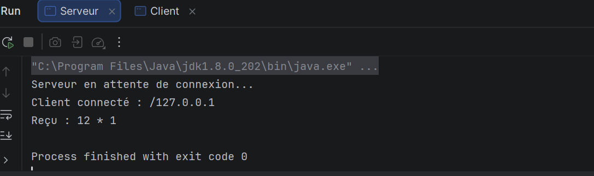
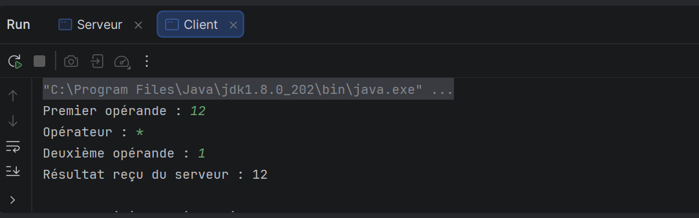

# DAR_TP2

## Développement d'applications réparties : Calculatrice Client/Serveur

**Étudiante :** Adsi Rayen

---

## Objectifs du TP

- Comprendre la communication entre un client et un serveur en Java.
- Utiliser les sockets TCP.
- Envoyer plusieurs données (deux opérandes et un opérateur) du client vers le serveur.
- Faire effectuer le calcul par le serveur et renvoyer le résultat au client.

---

## Description

Le client saisit un premier opérande, un opérateur et un deuxième opérande, puis les envoie au serveur. Le serveur affiche ce qu'il a reçu, effectue l'opération demandée et renvoie le résultat au client, qui l'affiche.

### Classes utilisées

- `serveurPackage.Serveur` : démarre le serveur, attend la connexion d'un client, reçoit les données, calcule et renvoie le résultat.
- `clientPackage.Client` : se connecte au serveur, saisit les opérandes et l'opérateur, envoie la requête et affiche le résultat reçu.

---

## Fonctionnement

1. Le serveur démarre et attend une connexion.
2. Le client se connecte au serveur (adresse `127.0.0.1` en local).
3. Le client saisit le premier opérande, l'opérateur, puis le deuxième opérande.
4. Le client envoie ces données au serveur.
5. Le serveur affiche la requête reçue, calcule le résultat et le renvoie au client.
6. Le client affiche le résultat reçu du serveur.

---

## Test

| Premier opérande | Opérateur | Deuxième opérande | Résultat obtenu |
|-----------------:|:---------:|------------------:|----------------:|
| 12               | `*`       | 1                 | 12              |

---

## Captures d'écran

**Console du serveur :**

**Console du client :**

---

## Ordre d'exécution

1. Lancer d'abord `Serveur`.
2. Lancer ensuite `Client`.
3. Saisir les valeurs demandées dans la console du client.

---

## Technologies utilisées

- Java (JDK 1.8)
- Sockets TCP
- `ServerSocket`
- `Socket`
- Git
- GitHub
- IntelliJ IDEA

---

## Conclusion

Ce TP permet de mettre en pratique les sockets TCP en Java : le client envoie une requête composée de plusieurs données, le serveur la traite et renvoie le résultat, ce qui illustre le fonctionnement d'une application répartie simple.
